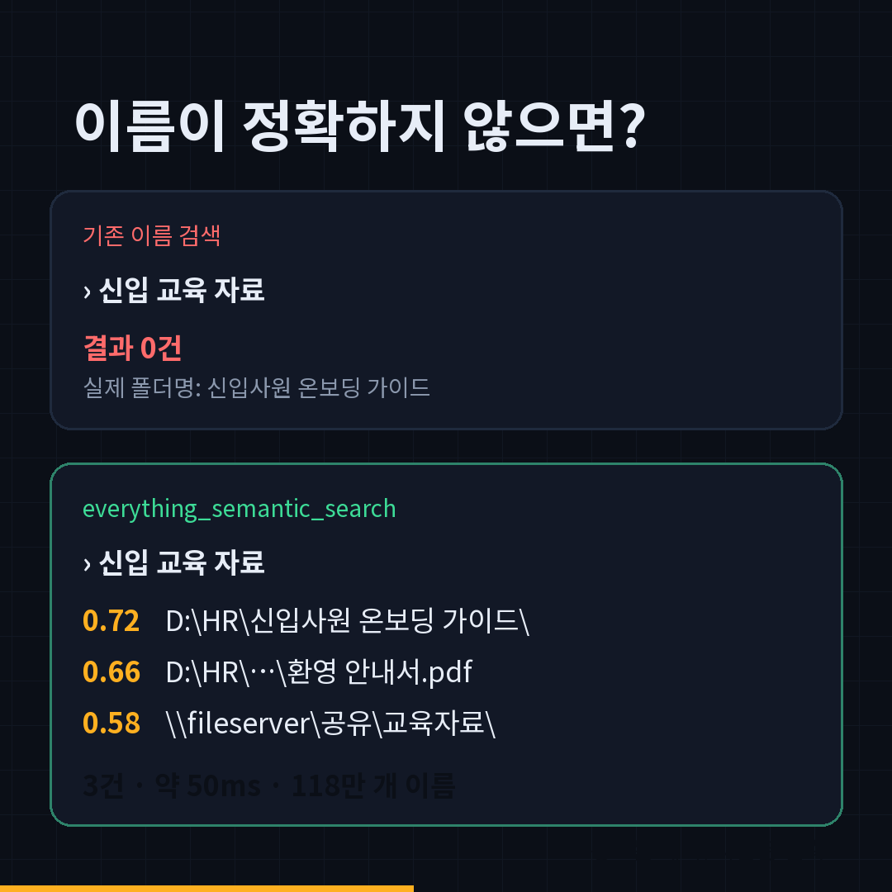

<div align="center">

# findex

**파일 이름을 몰라도 찾는 검색 — 사람은 검색 창으로, AI 에이전트는 MCP로.**<br>
Windows · macOS · Linux 실행 파일 하나. 설치·Python 불필요.

<b>한국어</b> · <a href="README.en.md">English</a>

<a href="promo/everything-semantic-mcp.mp4"></a>

**[⬇ 최신 버전 다운로드](https://github.com/yazzang-homelab/everything-semantic-mcp/releases/latest)**

</div>

---

## 이런 걸 찾습니다

| 이렇게 검색하면 | 이름 검색만으로는 | findex |
|---|---|---|
| `신입 교육 자료` | 0건 (예: 실제 폴더명이 "신입사원 온보딩 가이드"일 때) | 상위로 찾음 |
| `분기 매출 보고서 위치` | 0건 ("위치"라는 단어가 이름에 없음) | "2026 Q3 매출 보고서" 폴더 상위 |
| `budget ext:xlsx dm:last30days` | 정상 | 그대로 정확 검색 |

- **이름 검색**: Everything 문법(`ext:`, `path:`, `dm:`, `size:`, `folder:`, `!`, `|`, `*`).
- **단어 하나가 안 맞아도**: 모든 단어가 들어간 항목이 없으면, 가장 많은 단어가 맞는 순으로 보여줍니다(BM25 보조).
- **뜻으로 찾기**: 폴더·문서 이름을 다국어 임베딩으로 색인. 한국어·영어 섞어도 됩니다. 전부 내 PC 안에서.

## 시작하기 (1분)

1. **[Releases](https://github.com/yazzang-homelab/everything-semantic-mcp/releases/latest)** 에서 내 OS 파일을 받습니다.

   | OS | 파일 |
   |---|---|
   | Windows 10/11 | `findex-windows-x64.exe` |
   | macOS Apple Silicon (M1~) | `findex-macos-arm64` (Intel Mac: 소스로 실행, 아래 참고) |
      | Linux x64 | `findex-linux-x64` |

2. **실행** — 더블클릭하면 브라우저에 검색 창이 열립니다.
   - Windows SmartScreen이 막으면 "추가 정보 → 실행" (서명 인증서 없는 오픈소스 빌드).
   - macOS: 터미널에서 `xattr -d com.apple.quarantine ~/Downloads/findex-macos-*; chmod +x ~/Downloads/findex-macos-*` 후 실행.
   - Linux: `chmod +x findex-linux-x64 && ./findex-linux-x64`

3. **처음 한 번** 검색 창 위쪽의 **"의미 색인 만들기"** 를 누릅니다(모델 약 120MB 자동 다운로드, 수 분).

### 어떤 색인을 쓰나요?
- **Windows + [Everything](https://www.voidtools.com/ko-kr/) 실행 중** → Everything의 색인을 그대로 사용(수백만 개도 즉시).
- **그 외(macOS·Linux·Everything 없는 Windows)** → findex가 자체 색인을 만듭니다. 첫 실행 때 홈 폴더(Windows는 고정 드라이브 전체)를 스캔합니다.
  - 범위 바꾸기: `findex roots add /Volumes/NAS`, `findex roots remove ~/Downloads`, 다시 스캔: `findex scan`

## AI 에이전트에 연결 (MCP)

실행 파일 경로를 `command`로, 인자 `mcp`를 넣으면 됩니다.

**Claude Code**
```bash
claude mcp add findex -- /경로/findex mcp
```

**Claude Desktop** (`claude_desktop_config.json`)
```json
{ "mcpServers": { "findex": { "command": "C:\\Tools\\findex-windows-x64.exe", "args": ["mcp"] } } }
```

**Codex CLI / Cursor / gjc 등**: 같은 `command` + `args: ["mcp"]`.

에이전트가 쓰는 도구:

| 도구 | 용도 |
|---|---|
| `everything_find` | **자연어 요청 한 번에** — 이름 매칭 + 의미 검색 융합 |
| `everything_search` | 정확한 이름 검색·필터·정렬 (0건이면 가장 많이 맞는 순으로 자동 완화) |
| `everything_count` / `everything_recent` / `everything_largest` | 건수 비교 / 최근 수정 / 큰 파일 |
| `everything_semantic_search` / `everything_semantic_reindex` | 의미만으로 검색 / 의미 색인 생성 |
| `everything_status` / `everything_rescan` | 상태 / 자체 색인 재스캔 |
| `everything_health` / `everything_maintain` | Everything 설정 자가 진단 / DB 저장·재스캔 (Windows + Everything) |

## 명령줄

```
findex                 검색 창 열기 (기본)
findex mcp             MCP 서버 (stdio)
findex scan            자체 이름 색인 새로고침
findex reindex         의미 색인 만들기
findex roots [add|remove DIR]   자체 색인 범위
findex status | health
```

## 측정값

Windows 11 · i7-1255U · Everything 1.4.1.1032 x64 · 색인 6,126,653 항목(로컬 + 네트워크 폴더):

| 항목 | 값 |
|---|---|
| 의미 색인 | 1,177,343개 이름, 생성 264초 |
| 의미 검색 1회 (중앙값) | 45~58 ms |
| `find` (이름+의미 융합, 예열 후 중앙값) | 약 440 ms |
| 2단계 재정렬 recall@20 | 0.98 (전수 256차원 대비) |
| 시작 직후 첫 의미 검색 | 모델 로딩 약 20초 — 검색 창은 이름 결과를 먼저 보여주고 의미 결과는 준비되면 합류 |

실제 사내 경로 78만 개로 평가한 검색 방식 비교(한 단어가 이름에 없는 질의 200개): 엄격한 이름 검색은 89%가 0건, 단어 완화 + 순위(findex)는 53%가 상위 10위 안에 정답. 주제 질의 20개는 이름+의미 융합이 상위 10위 적중 0.90~0.95.

## 개인정보
- 파일 내용은 읽지 않고 **이름·경로·크기·날짜만** 색인합니다.
- 모든 처리는 내 PC 안에서. 외부 전송은 최초 모델 다운로드(Hugging Face)뿐입니다.
- 색인 위치: Windows `%LOCALAPPDATA%\findex`, macOS `~/Library/Application Support/findex`, Linux `~/.local/share/findex`. 경로가 평문으로 저장되니 공유 PC라면 권한을 확인하세요.
- 검색 창은 `127.0.0.1`에만 열립니다(외부 접속 불가).

## 소스로 실행 / 개발
```bash
git clone https://github.com/yazzang-homelab/everything-semantic-mcp
cd everything-semantic-mcp
pip install -e ".[dev]"
findex            # 또는 python -m everything_semantic_mcp
pytest
```
실행 파일 빌드: `cd packaging && pyinstaller findex.spec` (각 OS에서). 태그(`v*`)를 올리면 GitHub Actions가 4개 OS용으로 빌드·테스트·릴리스합니다.

## 관련 프로젝트
[elis132/everything-mcp](https://github.com/elis132/everything-mcp)(es.exe 기반, 느린 쿼리 보호), [mamertofabian/mcp-everything-search](https://github.com/mamertofabian/mcp-everything-search)(SDK DLL, macOS/Linux 지원). findex는 독립적으로 작성했고 **의미 검색 + 단어 완화 검색 + 사람용 검색 창 + 단일 실행 파일**에 집중합니다.

## 라이선스
MIT. voidtools Everything의 비공식 연동이며, Everything은 voidtools의 상표입니다.
