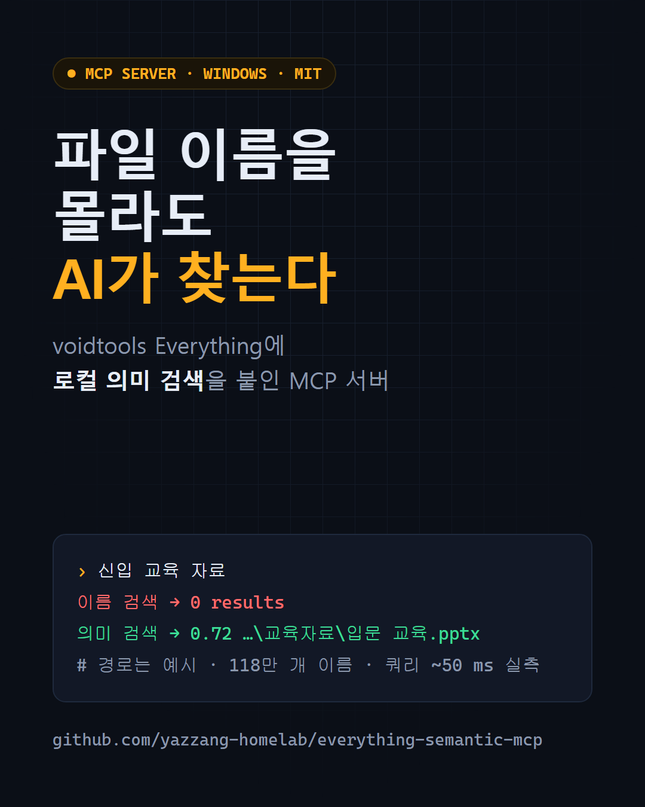

<div align="center">

# everything-semantic-mcp

**파일 이름을 몰라도 AI가 찾아줍니다.**<br>
[voidtools Everything](https://www.voidtools.com/ko-kr/) 위에 **로컬 의미 검색**과 **색인 자가 진단**을 얹은 MCP 서버

<b>한국어</b> · <a href="README.en.md">English</a>



</div>

---

## 핵심 기능

### 1. 의미 검색 — 이름이 아니라 뜻으로
Everything은 이름의 **부분 문자열**만 맞춥니다. "신입 교육 자료"로 찾으면 실제 폴더명이 "신입사원 온보딩 가이드"일 때 0건입니다. `everything_semantic_search`는 폴더·문서 이름을 다국어 임베딩으로 색인해 **뜻이 가까운 것**을 찾습니다.

- **완전 로컬**: GPU·API 키·클라우드 전송 없음. 처음 한 번 모델(약 120MB)만 내려받습니다.
- **가볍고 빠름**: [Model2Vec](https://github.com/MinishLab/model2vec) 정적 임베딩(토큰 조회 + 평균, ONNX·torch 불필요).
- **2단계 재정렬**: 64차원 PCA로 후보를 고르고 256차원 int8 벡터로 다시 순위를 매깁니다. 전수 256차원 검색 대비 recall@20 0.98, 쿼리당 약 50 ms.
- **한국어·영어 혼용** 질의 지원 (`"회의록"`, `"budget report"`).

### 2. 자가 진단·정비 — Everything이 멈추는 이유를 찾아줍니다
`everything_health`는 Everything.ini와 상태를 읽어, 실제로 Everything을 "응답 없음"으로 만든 설정들을 찾아내고 해결법을 함께 돌려줍니다.

| 진단 | 영향 |
|---|---|
| NTFS로 색인 중인 드라이브를 폴더 색인에 **이중 등록** | 메모리 약 2배, 전체 재스캔 반복 |
| 네트워크·클라우드 폴더에 **변경 감시** 켜짐 | 알림 버퍼가 넘쳐 전체 재스캔 |
| 재스캔이 **일반 I/O 우선순위** | 재스캔 중 UI 멈춤 |
| 놓친 예약 재스캔을 **시작 시 즉시 실행** | 켤 때마다 전체 재스캔 |
| 색인 DB가 **오래 저장 안 됨** | 강제 종료돼 매번 재구축 |
| **32비트** 빌드 | 2GB 주소 공간 한계로 대형 색인에서 멈춤 |

`everything_maintain`으로 DB 저장·폴더 재스캔·재구축을 실행할 수 있습니다.

### 3. 순수 Python IPC — es.exe·SDK DLL 없음
Everything이 공식 문서로 제공하는 IPC(`WM_COPYDATA` / `EVERYTHING_IPC_QUERY2`)로 직접 통신합니다.

- **크기·날짜가 응답에 포함** → 파일마다 `os.stat()`을 하지 않아 NAS·공유폴더에서도 빠릅니다.
- **색인된 속성만 요청** → 색인 안 된 생성일을 요청하면 Everything이 결과마다 디스크를 읽어 수십 초가 걸리는 문제를 피합니다.
- 한글·UNC 경로(`\\server\share`), 이름 붙은 인스턴스(Everything 1.5a 등) 지원.

---

## 실측 성능

| 항목 | 값 |
|---|---|
| 색인 항목 수 | 6,126,653 (로컬 + 네트워크 폴더) |
| 이름 검색 (100건, 중앙값) | 83 ~ 940 ms (질의에 따라) |
| 의미 색인 대상 / 빌드 시간 | 1,177,343개 이름 / 264초 |
| 의미 검색 1회 (중앙값) | 45 ~ 58 ms |
| 2단계 재정렬 recall@20 | 0.98 (전수 256차원 대비) |
| 진단대로 설정 수정 후 Everything 메모리 | 635 MB(응답 없음) → 약 350~400 MB |

**측정 조건**: Windows 11 · Intel i7-1255U · Everything 1.4.1.1032 x64 · Python 3.13. 직접 재현: `python benchmarks/bench.py --reindex`. 수치는 이 환경 기준이며 색인 규모·디스크·네트워크에 따라 달라집니다.

---

## 설치

### 준비물
1. **Windows** + [Everything](https://www.voidtools.com/ko-kr/) 설치 후 **실행 중**(트레이 아이콘). 수백만 항목이면 **64비트판** 권장.
2. **[uv](https://docs.astral.sh/uv/)** (`winget install astral-sh.uv`) 또는 Python 3.10+.

### 실행 확인
```powershell
uvx --from "everything-semantic-mcp[semantic] @ git+https://github.com/yazzang-homelab/everything-semantic-mcp" everything-semantic-mcp status
```

의미 검색이 필요 없으면 `[semantic]`을 빼면 됩니다. 기본 설치는 `mcp` 하나만 의존합니다.

### MCP 클라이언트 등록

아래에서 `SPEC`은 `"everything-semantic-mcp[semantic] @ git+https://github.com/yazzang-homelab/everything-semantic-mcp"`입니다.

**Claude Code**
```powershell
claude mcp add everything -- uvx --from SPEC everything-semantic-mcp
```

**Claude Desktop** (`%APPDATA%\Claude\claude_desktop_config.json`)
```json
{
  "mcpServers": {
    "everything": {
      "command": "uvx",
      "args": ["--from", "everything-semantic-mcp[semantic] @ git+https://github.com/yazzang-homelab/everything-semantic-mcp", "everything-semantic-mcp"]
    }
  }
}
```

**gjc (Gajae Code)** (`~/.gjc/agent/mcp.json`)
```json
{
  "mcpServers": {
    "everything": {
      "type": "stdio",
      "command": "uvx",
      "args": ["--from", "everything-semantic-mcp[semantic] @ git+https://github.com/yazzang-homelab/everything-semantic-mcp", "everything-semantic-mcp"],
      "timeout": 30000
    }
  }
}
```

**Codex CLI / Cursor / 기타**: 위와 같은 `command` + `args`를 쓰면 됩니다.

### 의미 색인 만들기 (처음 한 번)
에이전트에게 "의미 색인 만들어줘"라고 하거나(`everything_semantic_reindex`), 직접:
```powershell
uvx --from SPEC everything-semantic-mcp reindex
```
색인은 `%LOCALAPPDATA%\everything-semantic-mcp\index`에 저장됩니다. 파일이 바뀌는 만큼 주기적으로 다시 만드세요. 예: 매일 새벽 5시 작업 스케줄러 등록
```powershell
schtasks /Create /TN "everything-semantic-reindex" /SC DAILY /ST 05:00 /TR "uvx --from \"everything-semantic-mcp[semantic] @ git+https://github.com/yazzang-homelab/everything-semantic-mcp\" everything-semantic-mcp reindex"
```

---

## 도구

| 도구 | 용도 |
|---|---|
| `everything_search` | Everything 문법 이름 검색 (`ext:`, `path:`, `dm:`, `size:`, `folder:` …) |
| `everything_count` | 질의 최대 20개의 건수만 한 번에 |
| `everything_recent` | 최근 수정 파일 (`today`, `last7days`, …) |
| `everything_largest` | 용량 큰 파일 |
| `everything_semantic_search` | 뜻으로 찾기 (폴더·문서 이름, 경로·종류 필터) |
| `everything_semantic_reindex` / `everything_semantic_status` | 의미 색인 생성 / 상태 |
| `everything_health` | 설정 자가 진단 (위 표) |
| `everything_maintain` | DB 저장 · 폴더 재스캔 · 재구축 |

CLI: `everything-semantic-mcp [serve|reindex|status|health]` (기본 `serve`).

## 환경 변수 (모두 선택)

| 변수 | 설명 |
|---|---|
| `EVERYTHING_INSTANCE` | 이름 붙은 인스턴스 (예: `1.5a`) |
| `EVERYTHING_SEMANTIC_DATA` | 의미 색인 저장 위치 (기본 `%LOCALAPPDATA%\everything-semantic-mcp`) |
| `EVERYTHING_SEMANTIC_SCOPE` | 의미 색인 대상 제한 (Everything 문법, 예: `path:"D:\Work"`) |
| `EVERYTHING_SEMANTIC_EXCLUDE` | 추가 제외 경로 (`;` 구분) |
| `EVERYTHING_SEMANTIC_EXTS` | 의미 색인할 문서 확장자 (`;` 구분) |
| `EVERYTHING_SEMANTIC_MODEL` | 임베딩 모델 (기본 `minishlab/potion-multilingual-128M`) |
| `EVERYTHING_SEMANTIC_IDLE_SEC` | 모델 미사용 시 메모리 해제까지 초 (기본 900) |

## 한국어 사용 팁
- 이름 검색은 **띄어쓰기 = AND**입니다. 실제 이름에 없는 단어(“자료”, “파일”)를 붙이면 0건이 됩니다 — 이럴 때 의미 검색을 쓰세요.
- NAS·공유폴더는 Everything의 `도구 → 옵션 → 색인 → 폴더`에 추가해야 검색됩니다. **변경 감시는 끄고 예약 재스캔**을 쓰세요.
- 의미 색인에는 개인 폴더가 섞이지 않게 `EVERYTHING_SEMANTIC_SCOPE`/`EXCLUDE`로 범위를 정하세요.

## 개인정보
- 모든 처리는 로컬에서 이뤄집니다. 파일 목록·이름이 외부로 나가지 않습니다(최초 모델 다운로드만 Hugging Face 접속).
- 의미 색인 파일에는 파일 경로가 평문으로 저장됩니다. 공유 PC라면 저장 위치 권한을 확인하세요.

## 관련 프로젝트
Everything용 MCP 서버는 이미 여럿 있습니다. 이 프로젝트는 별도로 처음부터 작성했고 다음이 다릅니다.

- [elis132/everything-mcp](https://github.com/elis132/everything-mcp) — es.exe 기반, 느린 함수 보호 규칙·파일 상세·통계 도구가 강점.
- [mamertofabian/mcp-everything-search](https://github.com/mamertofabian/mcp-everything-search) — SDK DLL 기반, macOS·Linux도 지원.

이 프로젝트는 **의미 검색**, **설정 자가 진단·정비**, **es.exe·DLL 없는 IPC**에 집중합니다. 이름 검색만 필요하면 위 프로젝트도 좋은 선택입니다.

## 개발
```powershell
git clone https://github.com/yazzang-homelab/everything-semantic-mcp
cd everything-semantic-mcp
uv venv; uv pip install -e ".[dev]"
pytest          # Everything이 실행 중이면 실제 IPC 테스트도 수행
ruff check src tests
```

## 라이선스
MIT. voidtools Everything의 비공식 확장이며, Everything은 voidtools의 상표입니다.
